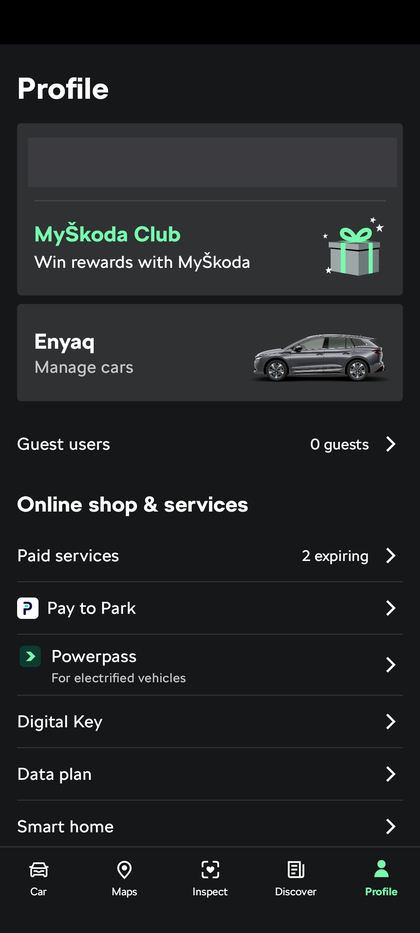
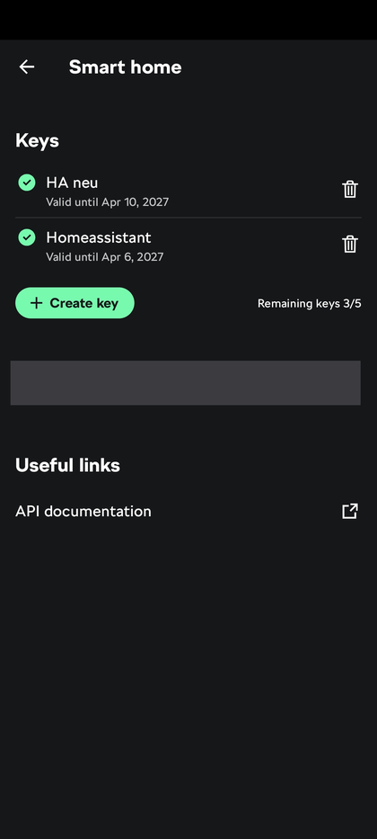

# Škoda API Connect voor Home Assistant

[🇬🇧 English](README.md) | [🇩🇪 Deutsch](README.de.md) | [🇳🇱 Nederlands](README.nl.md)

Een meertalige [Home Assistant](https://www.home-assistant.io/) custom integration voor
Škoda-voertuigen, gebouwd op de officiële
[MyŠkoda Public API](https://public.api.connect.skoda-auto.cz/docs). De integratie praat
rechtstreeks met de API via een **API-sleutel** - geen gebruikersnaam/wachtwoord en geen
externe client-bibliotheek.

> **Niet-officieel project.** Deze integratie is niet verbonden met, onderschreven door, of
> geassocieerd met Škoda Auto. Gebruik op eigen risico.

## Functies

| Platform | Entiteiten |
|---|---|
| `sensor` | Accuniveau, laadvermogen, laadlimiet (alleen lezen), laadsnelheid, resterende laadtijd, accu-/totaalbereik, brandstofniveau, AdBlue-bereik, kilometerstand, doeltemperatuur, adres van de parkeerpositie, deuren vergrendeld, betrouwbare vergrendelingsstatus en parkeerstatus (zoals de API ze meldt, bijv. `YES`, `TRUNK_OPENED`, `PARKED`), naam van het actieve laadlocatieprofiel (met id, laaddoel, volgende laadtijd en de lijst van alle profielen als attributen), API-status (resultaat van de laatste poll, diagnostisch), laatste API-poll (datum en tijd van de laatste geslaagde poll, diagnostisch), huidig pollinginterval (minuten, normaal of laadinterval, attribuut `mode`, diagnostisch), laatste voertuiggegevens (wanneer het voertuig zelf voor het laatst gegevens naar de Škoda-servers stuurde, diagnostisch) |
| `binary_sensor` | Deuren, ramen, kofferbak, motorkap, verlichting, centrale vergrendeling, laden, laadkabel aangesloten, vergrendeling laadkabel, voertuig op opgeslagen laadlocatie, geparkeerd, niet beveiligd (zie [Parkeeralarm](#parkeeralarm)) |
| `device_tracker` | Parkeerpositie (zichtbaar op de kaart; onbekend tijdens het rijden) |
| `climate` | Airco op afstand (aan/uit, actieve ventilatie als het voertuig die ondersteunt, doeltemperatuur), standkachel (alleen voor voertuigen die er een hebben, zie [Standkachel](#standkachel)) |
| `switch` | Laden starten/stoppen, stekker na het laden ontgrendelen per laadprofiel (zie [Laadprofielen](#laadprofielen)) |
| `button` | API nu opvragen (vraagt de MyŠkoda-API direct op voor het voertuig; kost één verzoek van het API-quotum en wordt geweigerd tijdens een rate limit), Voertuig wakker maken (zie hieronder) |
| `number` | Laadlimiet (doel-laadniveau), pollinginterval per voertuig (normaal / tijdens laden), automatisch wekken van een ladend voertuig, wachttijd parkeeralarm, looptijd standkachel, laaddoel per laadprofiel |
| `select` | Laadmodus (alleen als het voertuig zijn beschikbare laadmodi meldt), laadstroom per laadprofiel |

Sensoren en bediening worden alleen aangemaakt voor de gegevens en acties die jouw voertuig
meldt. In de opties kun je de **alleen-lezen-modus** inschakelen om alle bediening uit te
zetten.

### Wat de publieke API niet biedt

Deze integratie gebruikt uitsluitend de publieke MyŠkoda-API. Vergrendelen/ontgrendelen,
toeteren & knipperen, een echte wake-up-aanroep (de knop "Voertuig wakker maken" is slechts een omweg, zie hieronder), ruitverwarming, accuzorgmodus,
buitentemperatuur en softwareversie zijn daarom niet mogelijk: de publieke API heeft
daarvoor geen endpoint. De maximale laadstroom is alleen per laadprofiel te wijzigen (zie hieronder), niet als algemene instelling. De vergrendeling is een alleen-lezen `binary_sensor`.

## Ondersteunde talen

De integratie bevat vertalingen voor de config flow, de opties-flow en de entiteitsnamen in:

- English (`en`)
- Nederlands (`nl`)
- Deutsch (`de`)
- Français (`fr`)
- Čeština (`cs`)
- Slovenčina (`sk`)
- Español (`es`)
- Lëtzebuergesch (`lb`)

Home Assistant kiest automatisch de vertaling die overeenkomt met de taalinstelling van je
installatie, met Engels als terugvaloptie. Bijdragen voor extra talen zijn welkom — voeg een
nieuw bestand toe onder `custom_components/skoda_api_connect/translations/`.

Ook deze documentatie is beschikbaar in het [Engels](README.md), het
[Duits](README.de.md) en het [Nederlands](README.nl.md).

## Installatie

### HACS (aanbevolen)

[](https://my.home-assistant.io/redirect/hacs_repository/?owner=olafkenfenheuer&repository=Skoda-api-HA-Integration&category=integration)

1. Zoek in HACS naar "Škoda API Connect", klik op **Downloaden** en installeer de integratie.
2. Herstart Home Assistant.

Staat ze niet in de zoekresultaten (bijvoorbeeld omdat HACS de standaardlijst nog niet heeft
vernieuwd, of je wilt een pre-release uitproberen), voeg ze dan als aangepaste repository toe:

1. Ga in HACS naar **Integraties** → menu (⋮) → **Aangepaste repositories**.
2. Voeg de URL van deze repository toe
   (`https://github.com/olafkenfenheuer/Skoda-api-HA-Integration`) met categorie **Integration**.
3. Zoek in HACS naar "Škoda API Connect", klik op **Downloaden** en installeer de integratie.
4. Herstart Home Assistant.

### Handmatig

1. Download of clone deze repository.
2. Kopieer de map `custom_components/skoda_api_connect` naar de map
   `config/custom_components/` van je Home Assistant-installatie, zodat je uitkomt op
   `config/custom_components/skoda_api_connect/manifest.json`.
3. Herstart Home Assistant.

## Configuratie

1. Maak in de MyŠkoda-app een API-sleutel aan: open **Profiel → Smart home → Keys → Create key** (de namen in
   de taal van je app kunnen afwijken) en kies de voertuig(en) waarvoor hij geldt. Op een telefoon met de app moet
   <https://go.skoda.eu/api-keys> dit scherm direct openen (op een computer scan je de QR-code op de Škoda-pagina).
   Sleutels zijn aan die voertuigen gebonden en verlopen (de app toont de datum naast elke sleutel), en je kunt er
   maximaal 5 hebben. Hetzelfde scherm toont het **VIN** van het voertuig met een kopieerknop, dat je in stap 3
   nodig hebt.

   <p>
     
     
   </p>
   (Schermafbeeldingen van app-versie 8.18, Engels; naam en VIN zijn zwartgemaakt.)
2. Ga naar **Instellingen → Apparaten & services → Integratie toevoegen** en zoek "Škoda API Connect".
3. Voer de API-sleutel en het VIN van elk voertuig in (meerdere VIN's gescheiden door komma's).
   De API heeft geen voertuiglijst, dus de VIN's moeten handmatig worden ingevoerd.
4. Via **Configureren** wijzig je het pollinginterval (3-1440 minuten, standaard 10) of zet je
   de alleen-lezen-modus aan. Optioneel gebruik je het laadinterval ook zolang de laadkabel is aangesloten.
   Daar kies je ook de notify-services die het [parkeeralarm](#parkeeralarm) krijgen, of de entiteiten van een
   verwijderd [laadprofiel](#laadprofielen) worden verwijderd (alleen zichtbaar voor voertuigen met laadprofielen,
   standaard aan) en de **S-PIN** voor de [standkachel](#standkachel) (alleen zichtbaar als een voertuig er een
   heeft). Draait de airco of de standkachel, dan wordt het voertuig ook met het laadinterval gepolld.

Je kunt de API-sleutel (of de VIN's) op elk moment vervangen - vóór het verlopen of nadat je een nieuwe
hebt aangemaakt - via **Instellingen → Apparaten & services → Škoda API Connect → ⋮ → Opnieuw configureren**.
De invoer wordt herladen en behoudt entiteiten, geschiedenis en opties.

Verloopt de sleutel, dan vraagt Home Assistant om opnieuw te verifiëren: maak een nieuwe sleutel
aan en voer die in.

## Over de API

De integratie gebruikt uitsluitend de gedocumenteerde endpoints onder
`https://public.api.connect.skoda-auto.cz/api/v1/vehicles/{vin}` en authenticeert met de
`X-API-Key`-header.

De API laat een deel van de gegevens weg als ze dat nu niet kan ophalen (gemeld als `<DEEL>_UNAVAILABLE`,
zichtbaar in de attributen van de API-statussensor). Voor zo'n deel bewaart de integratie de laatst bekende
gegevens met hun oude tijdstempel in plaats van ze te laten vallen: anders zouden de entiteiten van dat deel
ontbreken na een herstart van Home Assistant op het verkeerde moment. Niet-ondersteunde of uitgeschakelde delen
worden niet aangevuld.

### Laadprofielen

Een laadprofiel is een opgeslagen laadlocatie van de MyŠkoda-app. Voor voertuigen die de operatie
`updateChargingProfile` vermelden en minstens één profiel melden, krijgt elk profiel drie bedieningen met
de naam van het profiel: **laadstroom** (`MAXIMUM` of `REDUCED`, de "stroombegrenzing" van de app), **laaddoel** (50 tot 100 %) en
**stekker na het laden ontgrendelen**, plus de **minimale laadgrens** (eronder laadt het voertuig meteen) en, als
het voertuig het meldt, een schakelaar om haar te activeren. Een voertuig neemt een profiel als geheel over, daarom haalt de integratie het
profiel vlak voor het verzenden opnieuw op en wijzigt alleen die ene instelling; timers en voorkeurslaadtijden
blijven zoals ze zijn. Een wijziging kost twee verzoeken van het quotum plus het verversen.

Getest op een Enyaq (2026): de laadstroom, het laaddoel, de minimale laadgrens, "stekker ontgrendelen", de
voorkeurslaadtijden en de timers (de app noemt ze "vertrektijden") van een profiel, aan- en uitgezet en met andere
tijden en dagen, alles in één commando; het toevoegen en verwijderen van een profiel. Niet getest: eenmalige
timers (`one_off_day`) en de schakelaar voor de minimale laadgrens (de Enyaq meldt hem niet). De
voorkeurslaadtijden gelden voor alle vertrektijden van het profiel, zoals de app zegt.

**Wanneer de profielen in Home Assistant verschijnen**

- Een profiel verschijnt pas als het **voertuig het aan de Škoda-servers heeft gemeld**. Na het aanmaken in de
  app heeft het voertuig misschien even tijd of een duwtje nodig: druk op **Voertuig wakker maken**, daarna op
  **API nu opvragen**. De sensor **Laadlocatie** (attribuut `profiles`) toont wat de API meldt; zolang de lijst
  leeg is, valt er niets te tonen. Een voertuig zonder opgeslagen laadlocaties heeft geen profielen en dus geen
  van deze entiteiten.
- De entiteiten van een profiel worden bij het instellen van de integratie aangemaakt, daarom **herlaadt de
  integratie zichzelf** als de profielen van een voertuig veranderen: een profiel is toegevoegd, verwijderd of
  hernoemd (de namen van de entiteiten worden bij het instellen overgenomen). Een wijziging moet in **twee
  polls achter elkaar** voorkomen (een verwijdering in drie), zodat een even foutief antwoord geen herlaad
  veroorzaakt; bij het normale pollinginterval duurt dat 10 tot 30 minuten. Alleen voertuigen die `updateChargingProfile` vermelden worden
  bewaakt. Je kunt ook handmatig herladen (Instellingen > Apparaten en diensten > Škoda API Connect > de drie
  puntjes > Opnieuw laden).

**Als een profiel in het voertuig of de app wordt verwijderd**

- De entiteiten worden **niet beschikbaar** zodra het voertuig het profiel niet meer meldt. Voor een verdwenen
  profiel wordt niets naar het voertuig gestuurd: de actie `update_charging_profile` weigert het ("The vehicle
  does not report this charging profile (any more)") voordat ze iets schrijft.
- Een verwijdering moet in **drie polls achter elkaar** voorkomen. Dan verwijdert de integratie de entiteiten
  van het verwijderde profiel uit Home Assistant en herlaadt ze zichzelf. Het verwijderen is een optie
  (**Configureren** > **Entiteiten van verwijderde laadprofielen verwijderen**, standaard aan, alleen zichtbaar
  voor voertuigen met laadprofielen); staat ze uit, dan blijven de entiteiten als niet-beschikbare entiteiten
  staan die je handmatig verwijdert, en het herladen gebeurt na twee polls. Dat gebeurt alleen zolang het voertuig
  `updateChargingProfile` nog vermeldt, zodat een voertuig waarvan de operaties even ontbreken zijn entiteiten niet
  kwijtraakt. Heb je de naam of het gebied van zo'n entiteit aangepast, dan is dat daarmee weg.
- Maak je daarna een nieuw profiel aan, dan kan het het id van het verwijderde krijgen; het krijgt dan verse
  entiteiten met dezelfde id's.

Timers en voorkeurslaadtijden zijn geen entiteiten (een profiel heeft tot 4 voorkeurslaadtijden en 3 timers). De
sensor **Laadlocatie** toont die van het profiel waar het voertuig staat als attributen, en de actie
`skoda_api_connect.update_charging_profile` wijzigt elke instelling, voorkeurslaadtijd en timer van een profiel:
kies een entiteit van het profiel als doel en geef alleen op wat moet veranderen. Een timer (de app noemt ze
"vertrektijden") of voorkeurslaadtijd wordt aangeduid met zijn `number` in het profiel (de eerste is 1) of met
het `id` dat de API meldt; die id's tellen over alle profielen heen, het tweede profiel van een voertuig kan dus
bij 5 beginnen (zie het voorbeeld in de Engelse README).

### Standkachel

Voertuigen met een standkachel (het voertuig vermeldt `startAuxiliaryHeating` en meldt de status) krijgen een
`climate`-entiteit **Standkachel** (uit, verwarmen, alleen ventileren) en een getal **Standkachel: looptijd**
(10 tot 60 minuten, standaard 30). Voertuigen zonder standkachel krijgen geen van beide.

De API start de verwarming alleen met de **S-PIN** van je MyŠkoda-account. Voer hem in onder **Configureren**
(het veld verschijnt alleen als een voertuig een standkachel heeft). Hij wordt net als de API-sleutel in Home
Assistant opgeslagen, in de diagnostiek geanonimiseerd en nooit gelogd. Zonder wordt starten geweigerd voordat
iets wordt verzonden. Een verkeerde S-PIN kan de S-PIN blokkeren, controleer hem dus eerst in de app. De
doeltemperatuur wordt bij elke start meegestuurd. Niet getest.

### Blueprint: een laadprofiel met beveiligingen wijzigen

[](https://my.home-assistant.io/redirect/blueprint_import/?blueprint_url=https%3A%2F%2Fgithub.com%2Folafkenfenheuer%2FSkoda-api-HA-Integration%2Fblob%2Fmain%2Fblueprints%2Fautomation%2Fskoda_api_connect%2Fupdate_charging_profile.yaml)

De blueprint **Škoda charging profile - change settings with safeguards** roept de bovenstaande actie aan als je
trigger afgaat en je voorwaarden gelden, voor trage, zeldzame wijzigingen: een tijdstip, een seizoen, de
huisbelasting. Je kiest het profiel, de te wijzigen velden (velden op "niet wijzigen" blijven zoals ze zijn), de
sensor **Resterende API-verzoeken** en een pauze. Er wordt alleen verzonden als de API nog genoeg verzoeken heeft
(een wijziging kost drie van 20 per uur), een eerdere wijziging niet nog bij het voertuig wacht, het profiel
beschikbaar is en, als je de API-statussensor kiest, de API werkt. Na een wijziging wacht hij de pauze af;
triggers in die tijd worden genegeerd.

Hij is niet bedoeld om elke minuut een overschot te volgen: het voertuig heeft 20 seconden tot enkele minuten nodig
om een wijziging over te nemen, en het quotum is klein. Gebruik daarvoor de wallbox. Wijzig hetzelfde profiel niet
tegelijk in de MyŠkoda-app. De blueprint staat in `blueprints/automation/skoda_api_connect/` van deze repository
(de import werkt pas als hij op de standaardbranch staat).

### Directe terugkoppeling na commando's

Een commando wordt door de API alleen *geaccepteerd* (HTTP 202); het voertuig voert het misschien veel
later uit, of nooit als het slaapt. Zodat de interface intussen niet onveranderd lijkt, tonen de airco,
de laadschakelaar, de laadlimiet en de laadmodus na een geaccepteerd commando direct de verwachte
toestand, met het attribuut `pending: true`. Die wordt vervangen zodra het voertuig nieuwere gegevens van
dat onderdeel meldt (wat het voertuig zegt wint, ook als het het commando tegenspreekt), en na 3 minuten
(airco) of 5 minuten (de overige) verworpen als het voertuig zich niet meldt. Een door de API geweigerd
commando verandert niets. Dit kost geen extra verzoeken.

### Voertuig wakker maken

Het voertuig meldt zich maar af en toe bij de Škoda-servers. Tijdens het laden kan het een uur lang
zwijgen, en de polls geven dan oude waarden terug hoewel ze slagen. De sensor **Laatste
voertuiggegevens** toont wanneer de auto zich voor het laatst meldde; **Laatste poll** toont alleen
wanneer de integratie voor het laatst gegevens ophaalde.

De API heeft geen wake-up-aanroep. De knop **Voertuig wakker maken** stuurt daarom de huidige laadmodus
opnieuw, een commando dat niets verandert maar het voertuig moet bereiken; het voertuig meldt zich meestal
binnen een minuut. Een voertuig zonder laadmodus (zoals een verbrandingsmotor) krijgt in plaats daarvan
een stopcommando, en wel voor de eerste functie van airco, standkachel en actieve ventilatie die het als
operatie vermeldt en die niet draait; een draaiende functie wordt nooit gestopt. Dit is niet getest: alleen
het opnieuw sturen van de laadmodus laat een voertuig aantoonbaar melden. Het getal **Ladend voertuig wekken na (0 = uit)** doet dit automatisch zolang een
voertuig laadt en zich het opgegeven aantal minuten niet heeft gemeld (standaard uit, minimaal 10). Elke
wekpoging kost twee verzoeken van het quotum; ze wordt overgeslagen tijdens een rate-limitpauze en als er
minder dan 6 verzoeken over zijn. Beide zijn niet beschikbaar in de alleen-lezenmodus.

### Pollinginterval per voertuig

Elk voertuig heeft twee `number`-entiteiten (configuratie): **Pollinginterval** en **Pollinginterval
tijdens laden**. Ze overschrijven de standaardwaarden uit de opties, werken direct zonder herladen
en zijn via automatiseringen in te stellen (`number.set_value`). Zodra de laatst opgehaalde status
`CHARGING` is, of de airco of ventilatie draait (zodat uitschakelen elders eerder zichtbaar wordt) (of, met de optie "Laadinterval ook gebruiken zolang de laadkabel is aangesloten", zodra de kabel
is aangesloten) wordt het laadinterval gebruikt; na het starten van het laden kan het dus tot één
normaal interval duren voordat het sneller pollen begint (laden starten via Home Assistant ververst
na 30 seconden meteen).

De schakelaar **Snel pollen als kabel is aangesloten** (categorie configuratie) doet hetzelfde per voertuig
en overschrijft voor dat voertuig de algemene optie.

### Parkeeralarm

De integratie kan een kritieke melding sturen als een voertuig geparkeerd staat
(`parkingPosition.state` is `PARKED`) maar een van deze voorwaarden geldt:

- Betrouwbare vergrendelingsstatus is niet `LOCKED` (overgeslagen als het voertuig hem niet meldt;
  de API meldt hem alleen voor sommige voertuigen)
- Deuren is niet `CLOSED`
- Deuren vergrendeld is niet `YES`
- Vergrendeld is niet `YES`
- Ramen is niet `CLOSED` (overgeslagen als de API `UNSUPPORTED` meldt, dus geen elektrische ramen)

Een waarde die als `UNKNOWN` wordt gemeld, of een van de andere velden die in het antwoord ontbreekt,
telt ook als niet beveiligd.

Om het aan te zetten open je **Configureren** en kies je een of meer **Ontvangers van het
parkeeralarm**, bijvoorbeeld `notify.mobile_app_mijn_telefoon`. De lijst toont je bestaande
notify-services; je kunt ook een naam typen. Leeg laten voor geen meldingen. De ontvangers gelden
voor alle voertuigen van de integratie.

De number **Wachttijd parkeeralarm** van elk voertuig (een schuifregelaar van 0 tot 30 minuten,
standaard 5, configuratiecategorie) bepaalt hoe lang het voertuig onbeveiligd mag blijven voordat de
melding wordt verstuurd; bij 0 meteen. De tijd loopt vanaf de eerste poll die het probleem toont, of
vanaf de melding van het voertuig zelf als die sinds de vorige poll (binnen één pollinginterval) kwam, en
de melding wordt alleen verstuurd als de laatste poll het nog toont. De toestand is alleen bij elke
poll bekend, dus de melding kan tot één pollinginterval later komen dan de wachttijd alleen doet
vermoeden. Gegevens die van vóór een herstart zijn opgeslagen, geven nooit een melding; het voertuig
moet eerst gepold worden.

Per incident wordt één melding verstuurd. Zodra een poll het voertuig beveiligd (of niet meer
geparkeerd) toont, begint het volgende probleem een nieuw incident. Open incidenten worden opgeslagen,
dus een herstart van Home Assistant of het herladen van de integratie stuurt de melding niet opnieuw. De binaire sensor
**Geparkeerd, niet beveiligd** toont dezelfde voorwaarde, met de mislukte controles in het attribuut
`reasons`, voor dashboards en je eigen automatiseringen.

Naar Companion-app-ontvangers (`notify.mobile_app_*`) gaat de melding als kritiek: op iOS klinkt hij
ook in stille modus en Focus, op Android gebruikt hij het alarmkanaal. Andere notify-services krijgen
een gewone melding. Alle ontvangers krijgen de melding tegelijk, en een ontvanger die faalt houdt de
andere niet tegen. De tekst van de melding is Engels.

Een voertuig kan zich lang niet bij de Škoda-servers melden, en een poll levert dan zijn laatste
melding, hoe oud ook. Daarom wordt de melding alleen verstuurd op gegevens die het voertuig bij of na het
begin van het incident meldde (de `carCapturedTimestamp` van de status); een oudere melding weet
misschien niet dat de auto intussen vergrendeld is. Een net geparkeerd voertuig meldt zich meestal één
keer en slaapt dan; omdat die melding het incident begint, is ze genoeg voor de melding. Is er aan het eind van de wachttijd geen zulke
melding, dan wekt de integratie het voertuig één keer per incident, net als de knop **Voertuig
wakker maken** (twee verzoeken van het quotum), en beslist op de melding die volgt. Het wekken wordt
Meldt het voertuig zich niet binnen 5 minuten na het wekken, mislukt het wekken of wordt het
overgeslagen (in alleen-lezen-modus, tijdens een rate-limit-pauze, als er minder dan 6 verzoeken van
het uurquotum over zijn en als er geen commando is om het voertuig te wekken: geen
bekende laadmodus en geen airco, standkachel of ventilatie die het voertuig vermeldt en die niet draait), dan wordt de melding toch verstuurd en eindigt ze met "Not confirmed: last
report at …": een voertuig dat stil blijft, mag de melding niet voorgoed tegenhouden. Afgezien
daarvan leest de melding alleen gegevens die de polls al hebben opgehaald en kost ze geen verzoeken.

Elke wekpoging (of waarom die werd overgeslagen of mislukte) en elke melding komt in het logboek van
de sensor **Geparkeerd, niet beveiligd** te staan, zodat je achteraf ziet waarom een melding kwam wanneer ze kwam.

### Rate limits

De API staat momenteel **20 verzoeken per uur per VIN** toe (niet definitief). Een poll kost
één verzoek per voertuig, elk commando nog één. Daarom:

- is het standaardinterval 10 minuten (minimaal 3; 3 minuten gebruiken al de hele limiet van 20 verzoeken per uur, zonder ruimte voor commando's) en 5 minuten tijdens het laden (of bij aangesloten kabel, als je die optie aanzet);
- wordt na commando's slechts één keer ververst, 30 seconden na het laatste commando;
- worden HTTP 429-antwoorden herkend en wordt het pollen gepauzeerd voor de door de API gemelde wachttijd (`Retry-After`,
  `RateLimit-Reset` of foutmelding; plus 30 seconden; maximaal 1 uur, 15 minuten als de API geen wachttijd geeft);
- blijft de laatst bekende status van een voertuig behouden als alleen zijn verzoek mislukt.

## Problemen oplossen

- **De link opent alleen het startscherm van de app.** Open **Profiel → Smart home** in de app handmatig (zie de
  schermafbeeldingen hierboven). Škoda documenteert niet in welke appversies of markten dit scherm bestaat; heb je
  geen item "Smart home", werk dan de app bij en vraag de Škoda-support.
- **API-status "partial" of entiteiten tonen oude waarden.** De API laat een deel van de gegevens weg als ze dat nu
  niet kan ophalen (`…_UNAVAILABLE`, vermeld in de attributen van de API-statussensor). De integratie bewaart dan
  de laatst bekende gegevens van dat deel met hun oude tijdstempel; de sensor **Laatste voertuiggegevens** toont
  hoe oud ze zijn. Meestal gaat het vanzelf over.
- **Het API-quotum is op (20 verzoeken per uur en voertuig).** De integratie pauzeert het pollen tot het terug is
  (API-status "rate_limited"). Alles wat dezelfde sleutel gebruikt telt mee, zoals de Swagger-pagina van Škoda of
  andere tools. Ook commando's kosten verzoeken; een wijziging van een laadprofiel kost er drie.
- **Een wijziging in de app en een vanuit Home Assistant overschrijven elkaar.** Het voertuig neemt een laadprofiel
  als geheel over, en de app slaat op zonder knop. Sluit de app terwijl je een profiel vanuit Home Assistant
  wijzigt, en controleer in de gegevens of het is aangekomen.
- **Een voertuig dat zich zelden meldt.** Een geparkeerd of ladend voertuig kan een uur zwijgen. Gebruik de knop
  **Voertuig wakker maken** of de optie om een ladend voertuig automatisch te wekken.

## Ontwikkeling

```bash
pip install pytest-homeassistant-custom-component
pytest
```

Zie [CLAUDE.md](CLAUDE.md) voor een overzicht van de code en conventies.

## Changelog

Zie [CHANGELOG.nl.md](CHANGELOG.nl.md) voor de release notes.

## Disclaimer

Aangeboden zoals het is, zonder garantie. Škoda Auto kan zijn API op elk moment wijzigen,
waardoor deze integratie kan stoppen met werken. Gebruik van de publieke MyŠkoda API valt
onder de eigen gebruiksvoorwaarden van Škoda.
